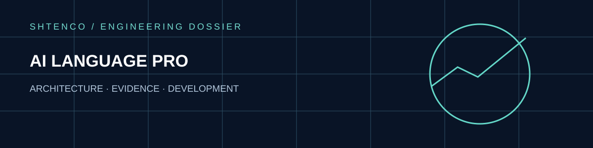

# AI LANGUAGE PRO / SEMANTIC DEVELOPMENT

**Source-indexed coding agent and experimental compiler.**

## Research proposition and implemented work

The source package has a repository-aware agent, stable REQ identifiers, AST-based symbol and call extraction, mutation and validation event history, semantic task, repository, change and impact graphs, and a small .ailang compiler emitting illustrative Python, C, Rust, Solidity and Kotlin scaffolds.

## Mathematical and scientific interpretation

Requirement coverage should be computed from explicit, validated acceptance criteria. A trace link proves causal attribution of an operation to a requirement, not semantic correctness of the generated code.

## High-value engineering roadmap

Run deterministic parser and compiler tests, check change trace serialization, confirm CLI behavior and require target-language compilation plus sandboxed command execution.

## Architecture / implementation provenance

- [`src/ai_language/semantic_trace.py`](src/ai_language/semantic_trace.py)
- [`src/ai_language/pipeline.py`](src/ai_language/pipeline.py)
- [`src/ai_language/agent.py`](src/ai_language/agent.py)
- [`tests/test_semantic_trace.py`](tests/test_semantic_trace.py)

## Evidence and product framing

This project belongs to the SHTENCO engineering research portfolio. Its distinguishing mechanisms can underpin future applied systems, but the status of each claim is limited to the source and observed evidence. Deployment and financial effectiveness require independent repeatable evidence. No model outcome, status or yield is invented here.

**Research reading rule:** do not substitute explanatory diagrams for actual deployments; preserve repository-specific source files and build artifacts for independent verification.
